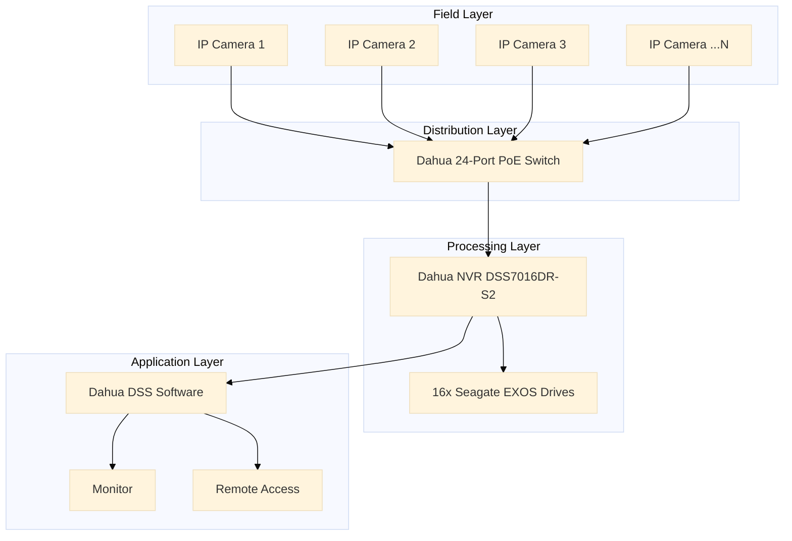
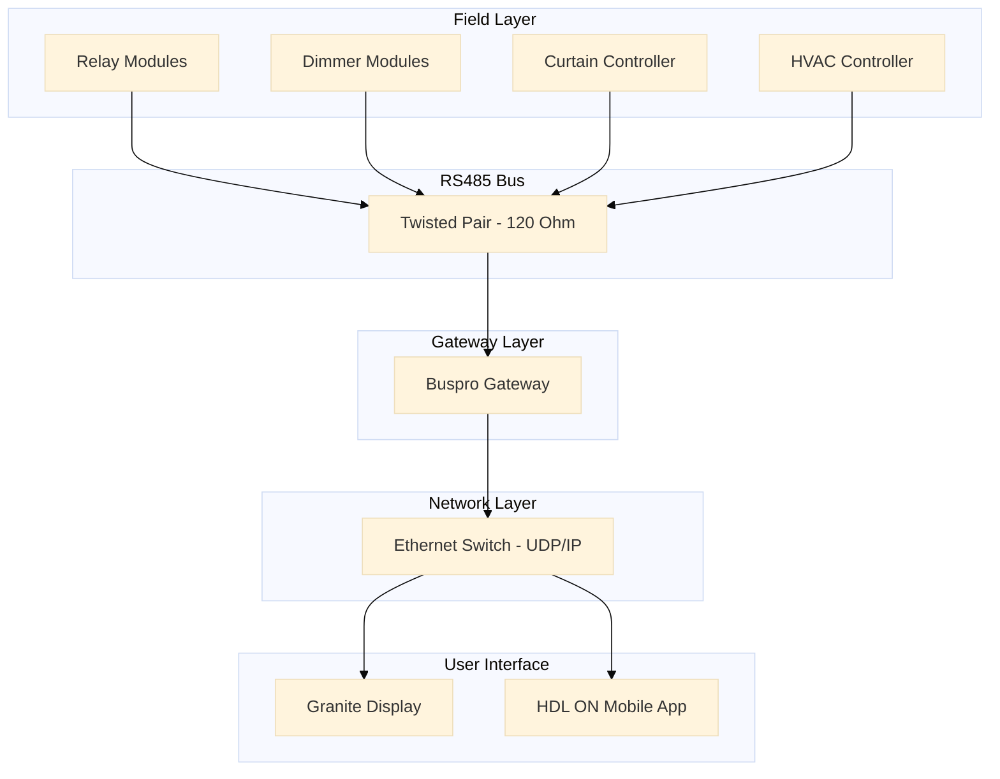

# Industrial Automation & Building Management Systems (SIWES 2023)

> **Status:** Hands-on Implementation / Assisted / Documented
> **Author:** Toluwanimi Jesusina
> **Company:** H&O Automation Systems Ltd., Gbagada, Lagos
> **Duration:** 22 Weeks (April 2023 – September 2023)

[](https://opensource.org/licenses/MIT)
[]()
[]()
[]()
[]()

---

## 1. Project at a Glance

| Aspect | Summary |
|--------|---------|
| **Objective** | Document practical exposure to commercial security and building management systems |
| **Focus Areas** | CCTV (Dahua), Access Control, Fire Alarm, HDL Buspro |
| **Key Evidence** | Field installation photos, NVR rack, PoE switch, DSS software, ABB/HDL panel |
| **Responsibility Levels** | Hands-on implementation · Assisted · Observed · Studied |
| **Limitations** | Client details redacted; no custom firmware developed |

---

## 2. What Is This?

A technical documentation repository based on my 22-week Students' Industrial Work Experience Scheme (SIWES) at H&O Automation Systems Ltd. It details the architecture, installation, configuration, and integration of CCTV, Access Control, Fire Alarm, and Home Automation systems for commercial and high-end residential buildings.

**Responsibility Levels:**

- **Hands-on Implementation** — I personally installed/configured
- **Assisted Implementation** — I helped under supervision
- **Observed** — I watched and learned
- **Studied** — I analyzed documentation and theory

**Client Confidentiality:** All images in this repository have been redacted to remove client-identifiable information. Permission for publication was obtained from H&O Automation Systems Ltd.

---

## 3. Why Was It Built?

To document real-world exposure to large-scale commercial security and building management systems. This repository serves as a knowledge base for industrial communication protocols (RS485, UDP/IP) and system integration, bridging academic theory with practical field experience.

---

## 4. System Architectures Documented

### 4.1 CCTV System (Dahua Ecosystem)



### 4.2 Home Automation (HDL Buspro)



### 4.3 Access Control

Studied: full-height turnstile, radar swing barrier, tripod turnstile, biometric turnstile.

### 4.4 Fire Alarm (Addressable)

Studied: loop-based addressing, Gent control panel, unique device addresses.

---

## 5. Hardware & Software Documented

| System | Hardware | Software |
|--------|----------|----------|
| CCTV | Dahua NVR (DSS7016DR-S2), 24-port PoE Switch, Seagate EXOS | Dahua DSS |
| Access Control | Card Readers, Biometrics, Turnstiles | Access Control Software |
| Fire Alarm | Gent Detectors, Control Panel | Gent Configuration Software |
| Home Automation | HDL Buspro Modules, Granite Display, ABB Enclosure | Buspro Setup Tool, HDL ON |

---

## 6. Engineering Principles Observed

1. **Redundancy** — UPS for CCTV and Fire Alarm panels during power outages
2. **Structured Cabling** — Proper cable management, Cat6 termination, RS485 twisted-pair wiring
3. **Safety Compliance** — Fire alarm systems must adhere to local fire codes
4. **Interoperability** — Systems from different manufacturers (Dahua, Gent, HDL, ABB) must integrate seamlessly

---

## 7. Field Installation

Photos document field installation of outdoor fixtures, camera mounting, NVR rack deployment, PoE switch installation, and ABB/HDL panel work.

**See:** [`media/field_work/`](media/field_work/) and [`media/cctv/`](media/cctv/)

---

## 8. Limitations

1. **Documentation vs. Design** — This repository documents systems I studied/assisted with, not systems I designed entirely
2. **No Custom Firmware** — Commercial systems use manufacturer firmware
3. **Site-Specific** — Client details, IP addresses, and exact locations are redacted

---

## 9. Future Development

| Priority | Enhancement |
|----------|-------------|
| 1 | Integrate HDL Buspro with Home Assistant via RS485 |
| 2 | Study PLC programming (Siemens, Allen-Bradley) |
| 3 | Explore SCADA systems for industrial monitoring |
| 4 | Develop custom IoT gateway for legacy systems |

---

## 10. Lessons Learned

1. **Interoperability is Key** — Industrial automation requires seamless integration between hardware from different manufacturers
2. **Documentation is Critical** — Accurate network diagrams and IP logs are essential
3. **Safety First** — Fire alarm systems are life-critical
4. **Protocol Hierarchy** — Physical layer (RS485) vs. network layer (UDP/IP)
5. **Physical Infrastructure Matters** — Clean software config is useless if physical cabling is poor

---

## 11. Author's Note

This placement taught me that commercial engineering is 30% technology and 70% logistics. I spent my first week just watching. My second week just asking questions. By week six I was pulling cables through conduits on a rooftop and understanding, for the first time, why structured cabling is a discipline. The clean diagrams I drew in my report took four revisions because the site reality kept changing. My biggest takeaway: never trust a wiring diagram you haven't verified with your own eyes.

---

## 12. Repository Structure

```
industrial-automation-and-bms-2023-siwes/
├── README.md
├── LICENSE
├── .gitignore
├── .gitattributes
├── docs/
│   ├── SIWES_Technical_Report_2023.pdf
│   ├── CCTV_System_Architecture.md
│   ├── Access_Control_Systems.md
│   ├── Fire_Alarm_Systems.md
│   ├── HDL_Buspro_Home_Automation.md
│   ├── Network_Topology.md
│   ├── NVR_Storage_Sizing.md
│   ├── ABB_HDL_Panel_Wiring.md
│   └── Field_Installation_Notes.md
└── media/
    ├── cctv/
    │   ├── nvr_rack/
    │   ├── poe_switch/
    │   └── dss_software/
    ├── home_automation/
    │   └── abb_hdl_panel/
    ├── field_work/
    └── network_diagrams/
```

---

## 13. License & Contact

MIT License — see [LICENSE](LICENSE).

**Toluwanimi Jesusina** · [LinkedIn](https://linkedin.com/in/toluwanimi-jesusina-30b547241) · [YOUR-EMAIL](mailto:jesusinatoluwanimi@gmail.com)

---

## 14. Acknowledgements

Grateful to the team at **H&O Automation Systems Ltd.** for the opportunity to learn from real-world deployments. All client-identifiable information has been redacted with their permission.
```
